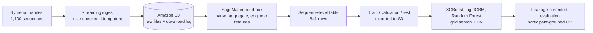

# Nymeria Motion Data: S3 Pipeline and Classification on AWS SageMaker

An end-to-end workflow on AWS: ingest 2,809 files from Meta's Nymeria egocentric motion dataset into S3, turn 173,616 narrated actions into a sequence-level modeling table, and compare XGBoost, LightGBM, and Random Forest classifiers. It also shows how to find and fix label leakage in a proxy-labeled problem.

Built for the Cloud Computing course in the University of San Diego M.S. in Applied Data Science program.

## Highlights

- **Idempotent S3 ingestion.** Streams files from the dataset manifest to S3 in 1 MB chunks, checks each object's size before uploading, and writes a download log back to S3, so reruns only fetch missing or incomplete files.
- **Sequence-level feature table.** Joins 1,100 metadata records with aggregated atomic-action narrations, plus motion trajectory, text complexity, and engineered behavior features.
- **Model comparison.** Grid-searched XGBoost, LightGBM, and Random Forest with stratified 5-fold CV, exporting train, validation, and test splits to S3 in SageMaker JumpStart format.
- **Leakage audit.** The engineered "discomfort" proxy label was defined from features the model could also see. A corrected evaluation drops those features and groups CV by participant.

## Architecture



## Data

[Nymeria](https://www.projectaria.com/datasets/nymeria/) (Meta Reality Labs) is a large dataset of real-world human motion captured with Project Aria glasses and wrist devices, with natural-language narrations of each action. This project uses the lightweight subset: per-sequence metadata (motion trajectories, durations, participant attributes) and atomic-action narration CSVs.

The dataset is licensed CC BY-NC 4.0. No raw data is stored in this repo; the notebook downloads it to your own S3 bucket.

## Results

### Corrected evaluation (participant-grouped 5-fold CV)

<!-- Fill in from the V3 section of the notebook -->

| Model | Accuracy | F1 | ROC-AUC |
|---|---|---|---|
| Majority baseline | TBD | TBD | 0.500 |
| Random Forest | TBD | TBD | TBD |
| XGBoost | TBD | TBD | TBD |
| LightGBM | TBD | TBD | TBD |

### What changed and why

The first modeling pass (V2) reported a test ROC-AUC of 0.989 for LightGBM. That score was inflated by two problems:

1. **Label leakage.** The `discomfort_proxy` label was defined with quantile thresholds on `efficiency_score`, `fragmentation`, and `motion_intensity`. The feature set included `fragmentation` directly, plus `head_trajectory_m` and `num_actions`, which are about 0.99 and 0.98 correlated with the other two label inputs. The models were reconstructing the labeling rule.
2. **Participant overlap.** A random split put different sequences from the same participant in both train and test.

The V3 section of the notebook removes every label input and anything correlated above 0.9 with them, then evaluates with `StratifiedGroupKFold` grouped by participant.

<!-- Add one or two sentences here once V3 is run, for example:
"With leakage removed, ROC-AUC fell to X, showing the proxy label is not predictable from independent behavioral features. A genuine discomfort label, such as participant self-reports, would be needed for this task." -->

## Repository structure

```
.
├── notebooks/
│   └── nymeria_pipeline_and_modeling.ipynb   # ingestion, features, modeling, V3 leakage fix
├── requirements.txt
└── README.md
```

## How to run

1. Open the notebook in a SageMaker Studio or notebook instance with an execution role that can read and write your bucket.
2. Set your bucket name:
   ```bash
   export NYMERIA_BUCKET=your-bucket-name
   ```
3. Upload the Nymeria manifest (`Nymeria_download_urls.json`, available after accepting the dataset terms on the Project Aria site) to the bucket root.
4. Install dependencies with `pip install -r requirements.txt` and run the notebook top to bottom.

## Possible next steps

- Replace the proxy label with a ground-truth target, such as participant self-reported comfort or the dataset's activity scenario labels.
- Add SHAP explanations and tune the decision threshold for recall on the positive class (outlined in the notebook).
- Move the ingestion step into a scheduled SageMaker Processing job.

## Credits

Group project with [Bart Teeuwen](https://github.com/bartteeuwen). This repo contains my ingestion pipeline, feature engineering, and modeling notebook. The original group repo is [here](https://github.com/bartteeuwen/USD-Data-Science-Cloud-Computing-Class).

Dataset: Ma et al., *Nymeria: A Massive Collection of Multimodal Egocentric Daily Motion in the Wild*, ECCV 2024.
