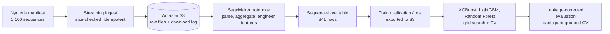

# Nymeria Motion Data: S3 Pipeline and Classification on AWS SageMaker

An end-to-end workflow on AWS: ingest 2,809 files from Meta's Nymeria egocentric motion dataset into S3, turn 173,616 narrated actions into a sequence-level modeling table, and compare XGBoost, LightGBM, and Random Forest classifiers. A leakage audit then shows that the original 0.99 ROC-AUC came mostly from the model reconstructing its own labeling rule, and measures what the data can actually predict.

Built for the Cloud Computing course in the University of San Diego M.S. in Applied Data Science program.

## Highlights

- **Idempotent S3 ingestion.** Streams files from the dataset manifest to S3 in 1 MB chunks, checks each object's size before uploading, and writes a download log back to S3, so reruns only fetch missing or incomplete files.
- **Sequence-level feature table.** Joins 1,100 metadata records with aggregated atomic-action narrations, plus motion trajectory, text complexity, and engineered behavior features.
- **Model comparison.** Grid-searched XGBoost, LightGBM, and Random Forest with stratified 5-fold CV, exporting train, validation, and test splits to S3 in SageMaker JumpStart format.
- **Leakage audit.** The engineered "discomfort" proxy label was defined from features the model could also see. A 2x2 ablation separates label leakage from participant overlap, and a reproducible local script reruns the whole pipeline without AWS.

## Architecture



## Data

[Nymeria](https://www.projectaria.com/datasets/nymeria/) (Meta Reality Labs) is a large dataset of real-world human motion captured with Project Aria glasses and wrist devices, with natural-language narrations of each action. This project uses the lightweight subset: per-sequence metadata (motion trajectories, durations, participant attributes) and atomic-action narration CSVs.

The dataset is licensed CC BY-NC 4.0. No raw data is stored in this repo; the notebook downloads it to your own S3 bucket.

## Results

All numbers below come from `scripts/run_local.py` on 841 sequences from 197 participants (60% positive class). The script reproduces the original SageMaker result (LightGBM test ROC-AUC 0.990 vs 0.989 in the notebook) before applying the fixes.

### Which fix matters? (LightGBM, 5-fold CV)

| Setup | Accuracy | F1 | ROC-AUC |
|---|---|---|---|
| Original features, random CV | 0.941 | 0.950 | 0.984 |
| Original features, participant-grouped CV | 0.944 | 0.953 | 0.984 |
| Leakage-free features, random CV | 0.817 | 0.849 | 0.884 |
| Leakage-free features, participant-grouped CV | 0.810 | 0.842 | 0.883 |

### Corrected model comparison (leakage-free features, participant-grouped CV)

| Model | Accuracy | F1 | ROC-AUC |
|---|---|---|---|
| Majority baseline | 0.600 | 0.750 | 0.500 |
| Random Forest | 0.819 | 0.848 | 0.885 |
| XGBoost | 0.805 | 0.839 | **0.888** |
| LightGBM | 0.810 | 0.842 | 0.883 |

### What happened

The `discomfort_proxy` label marks a sequence as positive when any of `efficiency_score`, `fragmentation`, or `motion_intensity` is in its top quartile. Those scores are computed from `num_actions`, `unique_actions`, `head_trajectory_m`, and `action_duration_sec`. The original feature set included `fragmentation` itself plus `num_actions` and `head_trajectory_m`, so the models could largely rebuild the rule.

The corrected evaluation removes every label input, every feature computed from one (`avg_words_per_action`, `wrist_motion_intensity`), and anything correlated above 0.9 with them (`observer_trajectory_m`), leaving 18 features.

- **Label leakage explained the inflated score.** Removing those features cut ROC-AUC from 0.984 to 0.883.
- **Participant overlap did not.** Grouping folds by participant changed ROC-AUC by less than 0.002, so the models are not memorizing individuals.
- **What 0.88 means.** Wrist motion, session timing, and narration text predict the proxy well above the baseline. Because the proxy is still a rule built from session statistics, this shows the other measurements carry information about pace and head movement. It does not show the models can detect physical discomfort; that would need a ground-truth label such as participant self-reports.

## Repository structure

```
.
├── notebooks/
│   └── nymeria_pipeline_and_modeling.ipynb   # original SageMaker workflow + leakage-corrected section
├── scripts/
│   └── run_local.py                          # runs the pipeline and leakage audit on a laptop
├── results/                                  # ablation and model comparison tables
├── requirements.txt
└── README.md
```

## How to run

### Locally (no AWS needed)

1. Request access to Nymeria on the [Project Aria site](https://www.projectaria.com/datasets/nymeria/) and download the `Nymeria_download_urls.json` manifest into the repo root. It is git-ignored, since the links are personal and expire.
2. Create an environment:
   ```bash
   conda create -n nymeria python=3.11 -y
   conda activate nymeria
   conda install -c conda-forge pandas numpy scikit-learn xgboost lightgbm requests -y
   ```
3. Run the pipeline:
   ```bash
   python scripts/run_local.py --manifest Nymeria_download_urls.json
   ```
   This downloads about 60 MB of metadata and narration files to `data/nymeria/`, rebuilds the feature table, reproduces the original V2 score, and writes the ablation and corrected comparison to `results/`.

### On AWS SageMaker

1. Open the notebook in SageMaker Studio with an execution role that can read and write your bucket.
2. Set `NYMERIA_BUCKET` to your bucket name and upload the manifest to the bucket root.
3. Install dependencies with `pip install -r requirements.txt` and run the notebook top to bottom.

## Possible next steps

- Replace the proxy label with a ground-truth target, such as participant self-reported comfort or the dataset's activity scenario labels.
- Check feature dependence with SHAP to see which of the 18 remaining features carry the most signal.
- Add SHAP explanations and tune the decision threshold for recall on the positive class (outlined in the notebook).
- Move the ingestion step into a scheduled SageMaker Processing job.

## Credits

Group project with [Bart Teeuwen](https://github.com/bartteeuwen). This repo contains my ingestion pipeline, feature engineering, and modeling notebook. The original group repo is [here](https://github.com/bartteeuwen/USD-Data-Science-Cloud-Computing-Class).

Dataset: Ma et al., *Nymeria: A Massive Collection of Multimodal Egocentric Daily Motion in the Wild*, ECCV 2024.
